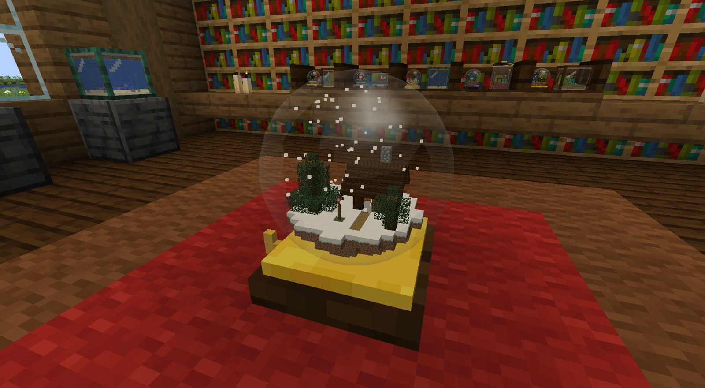
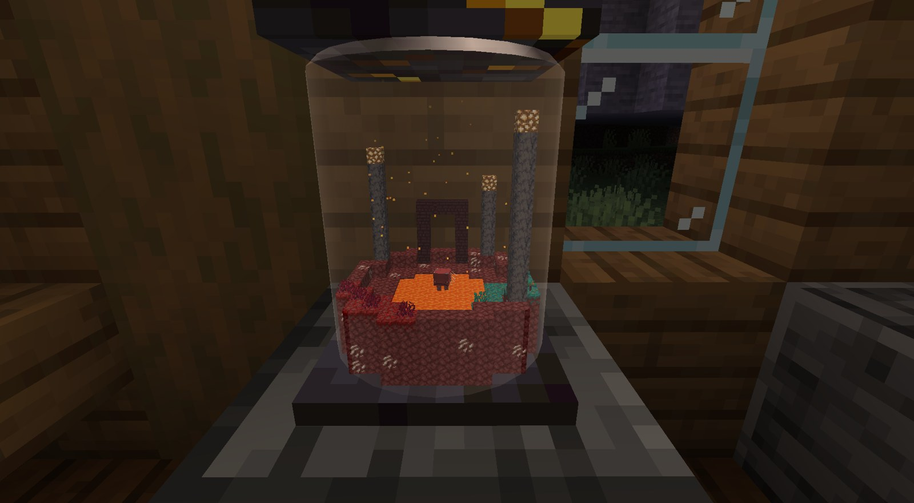
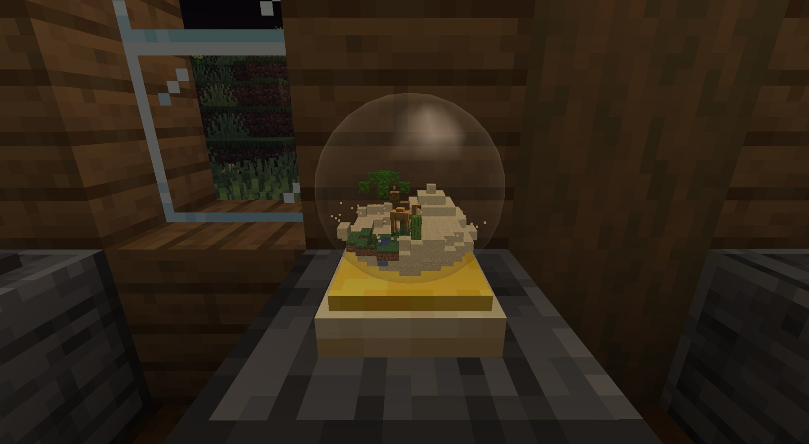
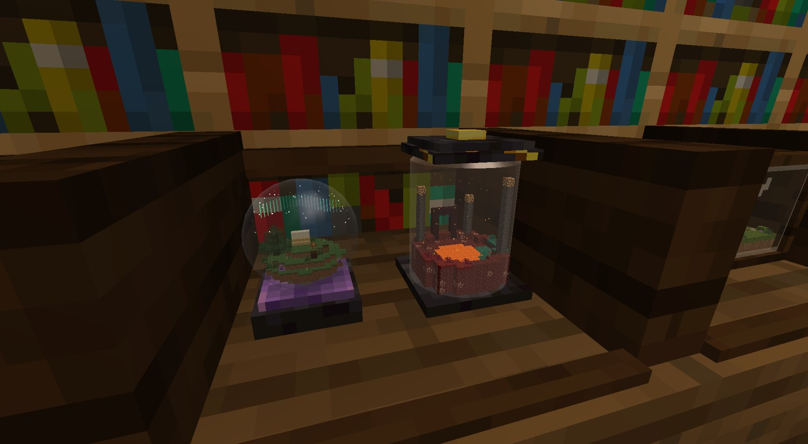
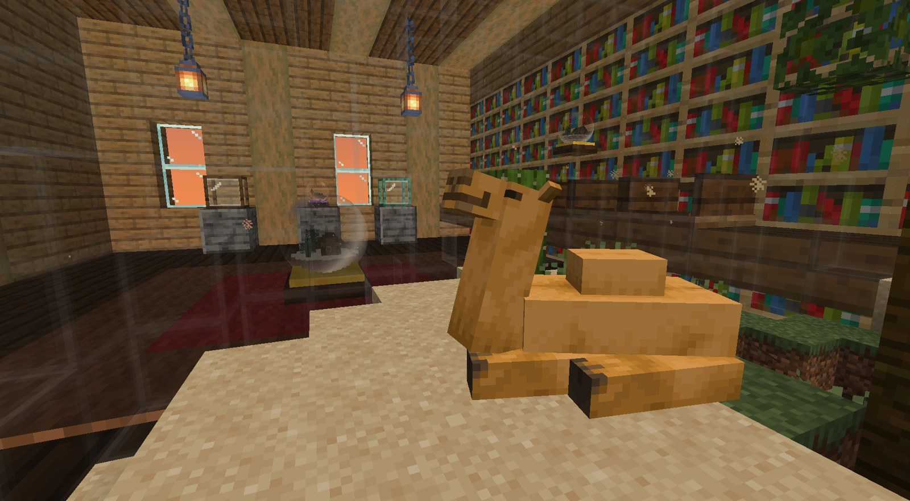

# Snow Globes

A Minecraft mod for building tiny worlds. Place a globe, step inside and build in a space of its own. Step back out and your build is there in miniature under the glass, with its water and mobs moving live.

**Minecraft 1.21.1 · NeoForge 21.1** · works alongside [Create](https://modrinth.com/mod/create) (optional)



Eight kinds: **snow globe, terrarium, storm globe, ship in a bottle, desert globe, aquarium, star globe and nether jar**. Each has its own weather and sky, and in creative each comes with a little scene to start from. They're in their own creative tab, with the collector's shelf and the handbook.

| | |
|---|---|
|  |  |
|  |  |
|  |  |

## How to use

- **Shake:** right-click the glass. A snow globe also moves on a season: winter, spring, summer, autumn. Shaken into winter, real snow settles inside.
- **Turn:** right-click the base.
- **Go inside:** sneak + right-click with an empty hand. **Leave:** right-click the glass wall from inside.
- **Knock:** punch the glass. Anyone inside hears a giant knock.
- **Fish:** use a fish bucket on a globe with water in it; a water bucket catches one back. Animals on a lead come in and out with you.
- **Display:** a collector's shelf holds two globes; a turntable spins the one on it; a name tag puts a name plate on the base.
- **Twins:** craft a globe that has a world in it with an empty one of the same kind and an ender pearl: two globes, one world.

Every globe starts as a **glass bulb**, blown from glass with a **glassblower's pipe**. Your first globe brings the **Globe Keeper's Handbook**, with the lore and all the recipes, and there's an advancement trail to follow. Wandering traders and old chests sometimes have globes with a world already in them.

## Inside

From inside, the real world around the globe is there, giant: the shelf it stands on, the globes next to it, and the players and animals nearby. Globes can stand inside other globes, and you can go in deeper still.



## Sizes and schematics

Globes grow to fit what's in them, from 16 to 256 blocks across, and bigger globes look bigger. Fill one with a Create schematic by right-clicking it with the schematic, or with any `.nbt` structure via `/globe import <file>`.

In survival nothing comes from nowhere: a new globe starts empty, an import uses the blocks from your inventory, and a globe won't shrink if that would cut blocks off.

## Commands and settings

Operator commands: `/globe import <file>` and `/globe size <16–256> [force]`, for the globe you're looking at or standing in. In the test game, `/globe debug showcase` builds a small gallery of globes in front of you, for screenshots.

Settings (Mods → Snow Globes → Config): how often lightning strikes, how much weather falls inside globes, and whether storm globes thunder for people outside.

## Installing

Put the mod on the server and on every player's game. Create is optional; without it, only Create schematic import is missing.

## Building

```bash
./gradlew build                              # the jar ends up in build/libs/
./gradlew runClient -PquickPlay="New World"  # test game with Create, opening that world
```

Java 21 is downloaded by Gradle if needed. Don't rebuild while `runClient` is running: the test game loads classes from `build/` and will crash. The Forge 1.20.1 version is under the git tag `forge-1.20.1`.

Known limits: spinning Create parts may not show in miniatures, and it's only been tested in single player and LAN so far.
