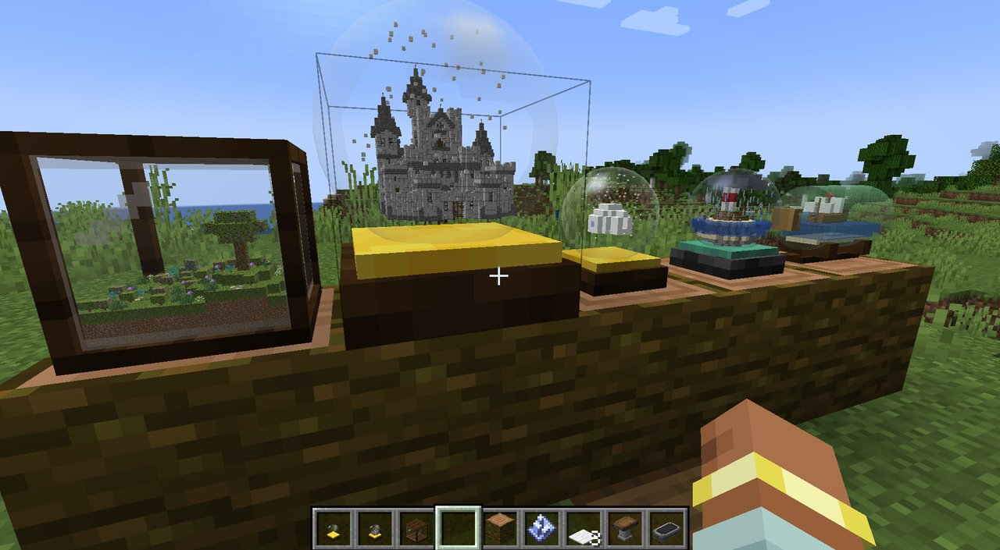
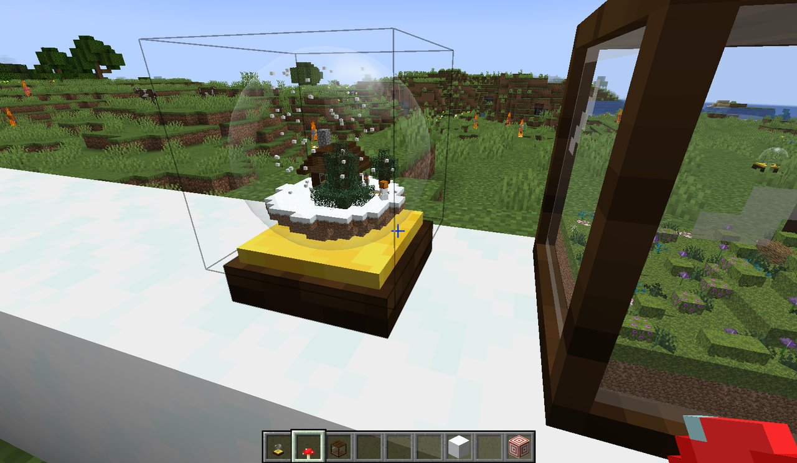
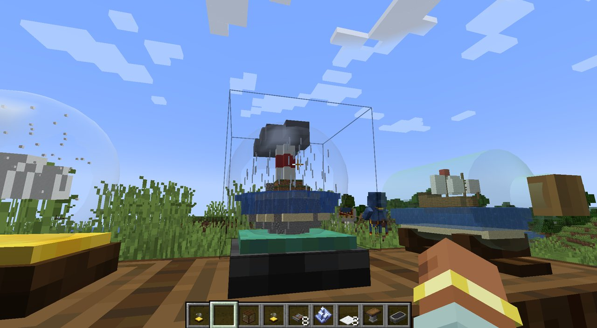
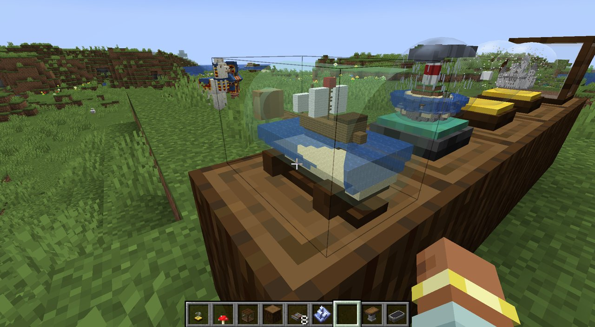
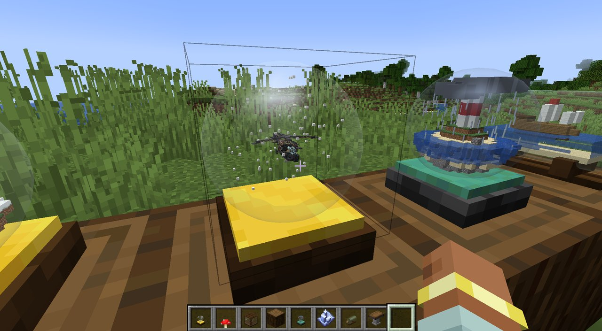
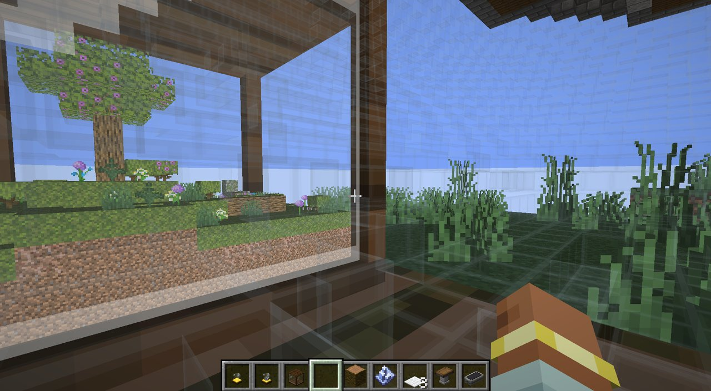
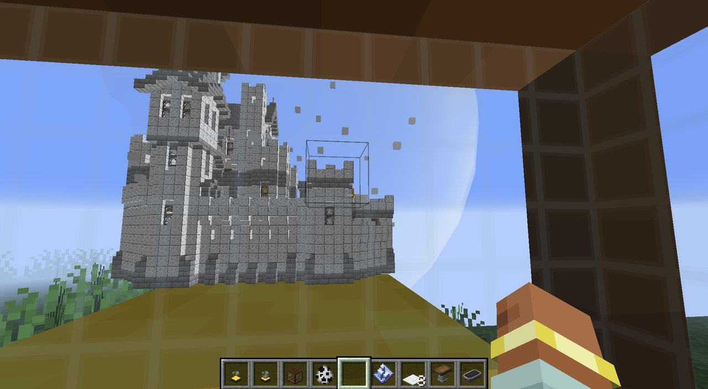
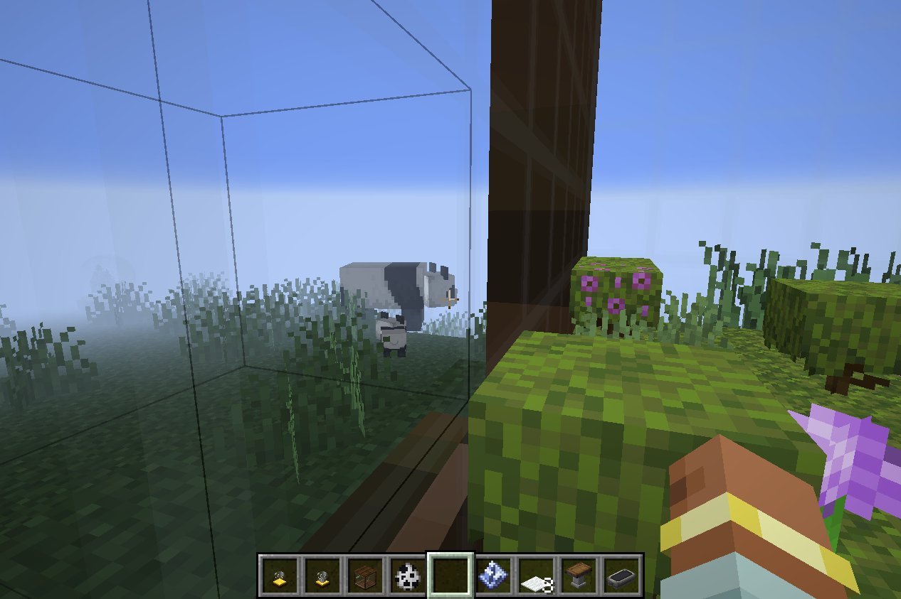

# Snow Globes

A Minecraft mod for building tiny worlds. Place a snow globe, a terrarium, an aquarium, a nether jar or one of four other globes, step inside, and build in its own private space. Step back out and your creation is there in miniature under the glass: blocks, water, and the mobs living in it, all moving live.

**Minecraft 1.21.1 · NeoForge 21.1** · works alongside [Create](https://modrinth.com/mod/create) (optional)



## Globes

| Globe | Outside | Inside (starter scene in creative) |
|---|---|---|
| **Snow Globe** | Glass ball on a dark-oak pedestal with a gold rim, snow falling inside | Snowy cabin, spruce trees, lamp post, a snow golem and a snow fox |
| **Terrarium** | Glass case in a wooden frame | Mossy garden: azalea tree, fallen log, rocks, flowers, frogs and a rabbit |
| **Storm Globe** | Dark glass on deepslate and oxidized copper, with clouds, rain and lightning | Striped lighthouse on a rocky island, with cod in the sea |
| **Ship in a Bottle** | Green glass bottle with a cork, on a wooden stand | Sailing ship on a strip of sea, with tropical fish |
| **Desert Globe** | Glass ball on sandstone, sand blowing across the dunes | Dunes, a stepped pyramid, an oasis with a palm, a camel and a desert rabbit, at sunset |
| **Aquarium** | Glass tank on dark prismarine, bubbles rising | Coral reef with kelp, seagrass, a sunken chest, tropical fish and an axolotl |
| **Star Globe** | Dark glass on blackstone, stars, northern lights and shooting stars inside | A camp on a hilltop under a night sky: tent, campfire, amethyst, a fox |
| **Nether Jar** | Glass jar with a blackstone lid, embers rising; it lights up the room | Lava pool, basalt pillars, crimson and warped fungi, a ruined arch, a strider |

They're all in their own **Snow Globes** creative tab, with the collector's shelf and the handbook. A globe you pick up keeps its contents, and the item shows the miniature too. Hold Shift over a globe for how to use it.

| | |
|---|---|
|  |  |
| **Snow Globe** | **Storm Globe** |
|  |  |
| **Ship in a Bottle** | **A Create helicopter in a globe** |

## Controls

| Action | How |
|---|---|
| **Shake** | Right-click the glass. The globe wobbles and chimes, and the snow whirls up. Anyone inside feels it. A snow globe also turns to the next season. |
| **Turn** | Right-click the base or stand: a quarter turn. |
| **Go inside** | Sneak + right-click, with an empty hand. |
| **Leave** | Right-click the glass wall from inside, with an empty hand. |
| **Knock** | Punch the glass, in survival. Anyone inside hears a giant knock. |

## Inside a globe

- You build in a space of its own, **16 to 256 blocks** across: a dome for round globes, a box for the terrarium, a long cylinder for the bottle.
- Through the walls you see the **real world around the globe, giant**: the shelf it stands on, the other globes with their miniatures, and the players and animals nearby, fading into haze in the distance.
- Going in and out is a short zoom and white-out instead of a cut.
- Each globe has **its own sky and light**: day over the snow globe, a sunset over the desert, night with the northern lights in the star globe. The storm globe storms, with lightning in step with the miniature. The nether jar glows red, and the aquarium is underwater blue.
- **Weather falls around you**: the snow globe's season, blown sand, ash and embers, spores, rain.
- Globes can stand **inside other globes**, and you can go in further. Leaving takes you out one glass at a time.

## Seasons and company

- **Seasons:** shaking a snow globe turns the year: winter, spring (blossom), summer (fireflies), autumn (falling leaves). Shaken into winter, real snow settles on everything inside, and melts a few minutes later, or straight away in spring.
- **Fish:** use a bucket of fish (or an axolotl, or tadpoles) on a globe with water inside, and they swim in. The bucket keeps its water. A water bucket catches one back out.
- **Animals:** anything you're leading on a lead comes in and out with you.
- **Collector's shelf:** holds two globes side by side and keeps their miniatures up to date.

## The handbook and advancements

Your first globe comes with the **Globe Keeper's Handbook**: some lore, the recipes, and how everything works. You can also make one from a book and a glass block. There's an advancement trail too, from your first shake to owning every kind of globe.



| | |
|---|---|
|  |  |
| The castle globe next door | Pandas outside, as giants |

## Sizes

Globes grow to fit what you put in them: **16, 24, 32, 48, 64, 96, 128, 192 or 256** blocks. Bigger globes also look bigger: 1 block up to 32, 2 blocks up to 96, 3 blocks above that. Above 64 the miniature is simplified, with each tiny block standing for a small cube of blocks.

## Schematics

Fill a globe with any Minecraft structure file (`.nbt`), which is also the format Create saves:

- **With Create:** load a schematic at a Schematic Table, then right-click a globe with the schematic item.
- **Without Create:** put the `.nbt` file in the game's `schematics/` folder and run `/globe import <file>` while looking at a globe (or standing inside one).

The globe grows to the smallest size the build fits in. Create blocks inside a globe, such as copycats, keep their look.

## Survival rules

Nothing comes from nowhere, and nothing disappears:

- **Importing** in survival only works into an **empty** globe, and it uses the materials from your inventory (one item per block). If anything is missing, you get a list.
- **Shrinking** a globe (`/globe size`) is refused if it would cut off blocks. In creative, add `force` to cut them anyway.
- Globes placed in survival start **empty**. Only creative globes come with a starter scene and its mobs.

## Commands

Commands need operator permissions (cheats).

- `/globe import <file>` — fill the globe you're looking at, or standing in, from `schematics/<file>`.
- `/globe size <16–256> [force]` — resize that globe; everything inside stays centred.

In the test game only (`runClient`), `/globe debug knock|shake` acts from inside a globe as if someone outside did it, and `/globe debug showcase` builds a display plaza in front of you, with every kind of globe, for screenshots.

## Settings

In **Mods → Snow Globes → Config**: how rare lightning is, how much weather falls inside globes, whether you hear a storm globe's tiny thunder from outside,.

## Crafting

- **Snow Globe:** glass on top and sides, a snow block in the middle, planks along the bottom.
- **Terrarium:** the same, with a moss block in the middle.
- **Storm Globe:** glass with a lightning rod in the middle, polished deepslate and a copper block underneath.
- **Ship in a Bottle:** glass all round, a boat in the middle and a stripped oak log as the cork.
- **Desert Globe:** glass with a dead bush in the middle, cut sandstone along the bottom.
- **Aquarium:** glass with kelp in the middle, dark prismarine along the bottom.
- **Star Globe:** glass with a spyglass in the middle; polished blackstone, an amethyst shard and polished blackstone underneath.
- **Nether Jar:** a polished blackstone slab on top, glass at the sides and bottom corners, a magma block in the middle and polished blackstone below it.
- **Collector's Shelf** (makes 2): two sticks over three wooden slabs.
- **Globe Keeper's Handbook:** a book and a glass block.

## Installing

Install the mod on **both the server and every client**; it adds blocks, a dimension and network messages. Create is optional. Without it, everything works except right-clicking with a Create schematic.

## Building from source

The build needs Java 21, which Gradle downloads by itself if it's missing.

```bash
./gradlew build        # the mod jar ends up in build/libs/
./gradlew runClient    # a test game, with Create, Sable and Create Aeronautics loaded
./gradlew runClient -PquickPlay="New World"   # the same, opening that world straight away
```

On Windows, use `gradlew.bat`. The wrapper scripts set `jdk.net.unixdomain.tmpdir` to work around a Java pipe problem on some Windows setups; take that out if your machine doesn't need it.

Don't rebuild while `runClient` is running. The test game loads classes from `build/` as it goes and will crash.

## Performance

Miniatures, and the giant world seen from inside, are built once into meshes on the graphics card and redrawn in one step per frame, the way Minecraft draws chunks. A mesh is only rebuilt when that globe's contents change. So a 64-block castle costs about as much to draw as a small scene. Mobs, snow, rain and glass are drawn live.

## Known limitations

- Spinning Create parts (shafts, cogs) may not show in miniatures.
- Only tested in single player so far, not on a dedicated server.

## Project layout

- `src/main/java/com/nick/snowglobe/` — blocks, the globe dimension, snapshots, schematic import, networking
- `src/main/java/com/nick/snowglobe/client/` — the miniature, glass and weather rendering, the giant outside view, and effects
- `src/main/resources/` — models, textures, recipes and the globe dimension

The Forge 1.20.1 version of the mod is kept under the git tag `forge-1.20.1`.
